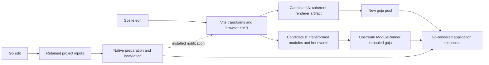
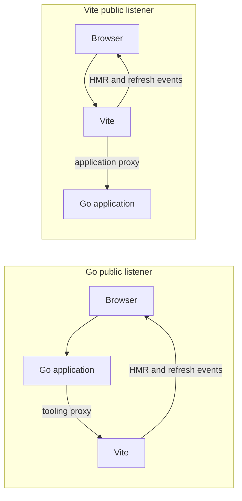

# Architecture choices supported by experiments

**Recommendation for selection:** compose the existing retained Go inputs and native patcher with Vite-produced renderer artifacts installed into fresh goja pools. Both Go-fronted and Vite-fronted public listeners worked; the measurements do not justify choosing between them on speed. Upstream ModuleRunner also works and remains an alternative. No architecture has been ratified and no candidate tactic is a requirement.

The controlling outcome is [GOAL.md](../../projects/dev-server/GOAL.md): save Svelte or Go and see the change quickly, Vite doing frontend development, Go serving/rendering the application, native patching on the normal Go edit path, restart as fallback, useful errors and visible recovery. Arbitrary initialized Go state preservation is unnecessary. The old PLAN supplies prior context only.

Base: freshly fetched origin/dev 868c5dba9bf1670d2252996b058ecf19bca659ca. Research and runnable experiments were brought from codex/vite-dev-integration into checkpoint 13ea7b8 without replacing newer dev implementation. All changes here are experimental; production behavior is unchanged.

## Three independent choices

| Choice | What ran | Evidence-supported implication |
|---|---|---|
| Go preparation | Current broad analysis, export-preserving loader, retained Session, retained View; same native generated handler | Existing retained View removes most repeated analysis; preserve caller coverage and host compatibility when integrating |
| Renderer delivery | Coherent rebuilt artifact, fresh upstream runner, retained runner receiving actual Vite HMR | Artifact replacement is cheaper in this fixture; runner viability is demonstrated, but its graph full-reloads here |
| Public listener | Go edge and Vite edge over the same Go SSR application | Both hydrate and refresh; choose by ownership/lifecycle/routing cost, not the sub-ms response difference |

These choices compose. Selecting a listener does not select a renderer or Go preparation strategy.

This is the composition under consideration, not a claim that every arrow ran together. Native preparation, renderer comparison and SSR/browser cooperation remain separate experiments. Native→Vite→browser had earlier bounded proof in the cache; this round's browser fixture changes a supplied Go value without compiling a patch.

## Measured costs

One macOS ARM64 machine, Go 1.27.2, pinned Kit 3.0.0/Svelte 5.57.1/Vite 8.3.1 through VitePlus Core 1.0.0. Final timing runs were coordinated to avoid our other heavy jobs. These small samples are observations, not throughput or large-app benchmarks. Different rows cover different work; **do not add them into an invented save-to-visible total**.

| Work | Observed time | Sample and boundary |
|---|---:|---|
| Current native preparation | 854 / 1164 / 913 ms | Three successive body edits |
| Export-preserving preparation | 273 / 302 / 296 ms | Three body edits |
| Retained Session preparation | 264 / 267 / 270 ms | Three body edits |
| Retained View preparation | 270 ms first; 138 / 137 ms warm | Two warm samples; install another 1.4–1.7 ms |
| Artifact renderer update + new pool + first render | About 45–57 ms | Four unchanged-importer dependency edits |
| Fresh runner graph import | 150–176 ms, plus 2.0–2.4 ms pool | Four dependency edits, warm Vite graph |
| Retained runner after actual Vite HMR | 152–170 ms | Four dependency edits; upstream full-reload |
| Go edge document response | p50 0.238 ms; p95 0.794 ms | 30 fixed-document requests |
| Vite edge document response | p50 0.881 ms; p95 1.628 ms | 30 equivalent requests |
| Integrated artifact rebuild + pool replacement | 77.13 ms | One actual frontend-edit control; excludes visible browser completion |

Warm retained View spends about 2 ms in analysis, 26 ms in native compilation and 108 ms rereading/hashing dependency archives. No identity check was removed. Retaining equivalent identities is an opportunity, not a demonstrated optimization.

The runner now executes actual Kit after Vite's resolver internalizes an OXC helper. No Go module graph or Vite port was built. However, actual Vite hot events in this graph say full-reload; upstream clears evaluated modules and reimports. That moves roughly 3.6 MB through over 400 module-transport calls per affected runtime. A better transport or acceptance boundary might change the result; neither was demonstrated. The artifact is approximately 124 KB and reuses the existing build environment/fold and renderer.

## Browser behavior and topology

Both arrangements returned Go-rendered markup, hydrated Kit, and used Vite events to refresh Go data while preserving supplied draft/count values. Ordinary Svelte HMR changed the heading and fresh Go SSR, but reset that component's draft/count. A real failed load reached an error boundary; repair plus a Vite event recovered positive content with reset state. Node did not render application pages.

Initial HTTP assertions passed while hydration failed: shared optimizer cache entries returned HTTP 504. Isolating the fixture's Vite cache fixed the observed browser failure. All failed observations remain preserved. The tested routing table, node metadata and bootstrap are fixed to the fixture; configured origins and full Kit routing precedence are not qualified by these two listener tests.

## What this supports choosing

Artifact replacement is the strongest demonstrated default candidate: lower update cost here, straightforward last-good candidate admission, and reuse of the current renderer. The runner is viable and is worth selecting if its closer dev-environment integration earns enough elsewhere to justify its current transport and per-runtime update cost. Go and Vite public edges are both feasible; neither is a meaningful latency optimization in this experiment.

The important remaining integration questions are dynamic Kit route/remote/matcher metadata, keeping full executable caller/dependency compatibility with retained inputs, automatic save/publication ordering, and restart/reconnect. These are limitations of the current experiments, not permission to invent a large framework or demand perfect unloading/state continuity. A representative combined application is the next qualification of a chosen composition; this round does not claim the finished dev server.

Independent negative controls withheld a native installation, supplied stale typed dependency analysis, and withheld renderer HMR delivery. All failed the supplied positive expectations. Unmodified native and renderer runs then passed. Concurrent requests caught a stale pooled renderer that a single serial render did not.

## Drill down

- [Go preparation: full table, correctness controls, coverage limits](go-preparation/README.md)
- [Renderer alternatives: module transport, HMR payloads, failure/repair](renderer/README.md)
- [Cooperation: HTTP proxy results, commands and fixture limits](cooperation/README.md)
- [Browser: actual observations and inspected screenshots](browser/README.md)
- [Independent validation: deliberate failures and positive reruns](validation/README.md)
- Token-cache copy: /Users/tyler/src/skgo-token-cache/experiments/architecture-20261015/
- Retrieval entrypoint: /Users/tyler/src/skgo-token-cache/index/README.md
