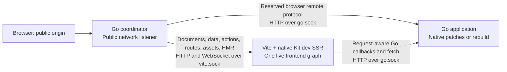

# SKGO development architecture: native Kit SSR with Go over Unix sockets

**Decision: adopt native Vite/Kit SSR as the development direction. The two-UDS/public-proxy topology works in a bounded runtime experiment. A fetch override alone is not the complete Go application bridge.** Production remains Go with pooled goja rendering.

Updated 2026-10-15 from the user's explicit direction and [linked discussion](codex://threads/01a141a2-423e-7360-9ab1-e17234bd620e). [GOAL](GOAL.md) controls. This is an architectural validation and handoff, not a claim that the product implementation is complete or authorized. Earlier development-renderer experiments and their measurements are preserved in [the historical assessment](DESIGN-go-ssr-historical.md).

## Architecture and why it is simpler



Kit owns the development HTML, server rendering modules and client bootstrap identities together. There is no independently built goja development renderer, renderer-pool replacement loop, second Kit graph, manifest publication gate or custom waiting page. This removes the specific split-graph mechanism that produced old SSR node50 against Vite's newly assigned node50. It does not promise that incomplete application edits never produce normal development errors.

Production continues to compile the renderer for the embedded Go engine. Native Kit dev success cannot substitute for production Go/goja checks, and production success cannot substitute for native dev checks. The user expressly permits this difference.

## Accepted limitation and parallel cookie research

The user explicitly accepts missing automatic SSR subfetch response-cookie propagation as a **known, non-blocking limitation**. Continue the architecture and handoff without waiting for a cookie fix. This acceptance concerns the SSR bridge; it does not silently relax unrelated authentication, inbound-cookie or direct browser-response behavior.

Response cookies are already readable inside the server hook through `response.headers.getSetCookie()`. The missing behavior in the minimal POC is applying them to Kit's pending request-cookie state and outer HTML response. Kit3 explicitly documents `event.cookies.parse()` followed by `event.cookies.set()` for importing cookies from an external response (`types/index.d.ts:369-391`). This is a supported candidate remedy, not yet runtime-qualified here. Preserve cookie attributes/scope and avoid exposing cookie values in serialized page data. A later custom UDS fetch also needs pending-cookie state rather than blindly copying the original inbound Cookie header.

[Cookie findings](../../experiments/20261015-vite-uds-cookies/FINDINGS.md) distinguish header access, same-request visibility, outer-response propagation and universal-load serialization restrictions. The subagent completed the upstream assessment: neither the documented replacement hook nor external fetch continuation promises automatic cookie adoption. Only Kit's internal-route continuation adopts response cookies. Recommend a documentation clarification first; an optional transport-only continuation could improve ergonomics, but existing public parse/set APIs already offer a remedy. Unconditional adoption outside the hook could change third-party/synthetic-response handling, duplicate cookie effects and apply the wrong rewritten-URL scope. It is not established as a non-breaking fix. No issue or message has been sent to SvelteKit, and the user has not authorized external posting.

## Addresses and lifecycle

Each session has a short private directory, shared with its child processes at startup:

```text
<session-directory>/vite.sock
<session-directory>/go.sock
```

The basenames are constant; the directory is unique per concurrent instance. Resolve absolute paths once from that directory rather than depending on child working directories. Keep the directory short enough for the platform's Unix socket pathname limit. Isolate Vite cache/output and Go session state too. A single project-global `go.sock` is not an instance-isolation design.

Go serves its existing HTTP interfaces on a Unix listener. Vite runs in supported middleware mode inside a Node HTTP server bound to `vite.sock`; Vite's WebSocket handler attaches to that server. The public Go proxy forwards HTTP and upgrades over Unix sockets. There is no private TCP-port discovery protocol. Kit and the browser still need the actual public origin, established after the coordinator binds its network listener.

Replacement reuses the known Go socket location. Socket ownership, readiness and cleanup remain supervisor responsibilities: an existing filesystem entry is not readiness, old connections can outlive a socket pathname, and an old process must not unlink a new owner's socket. The POC closes and reopens a listener within one Go harness at the same path; it does not prove separate-child restart or overlapping generations with in-flight requests.

## Routing and callback contracts

**Keep Kit's data/action orchestration with its renderer.** Routing `__data.json` to the old Go page dispatcher would reintroduce dependence on Go's separate node table.

| Surface | Development owner and delegation |
|---|---|
| Page document and `__data.json` | Kit owns branch selection, node identities, universal loads and serialization. Generated server-load bodies call Go. |
| Page action POST | Kit owns action selection, CSRF/content negotiation, action response and following loads. Generated action bodies call Go and map success/failure/redirect/error into Kit values. |
| `+server` route | Kit owns route/method/page-versus-endpoint selection. Generated endpoint body calls the Go handler and returns its status, headers and body. |
| Browser remote HTTP | Use the existing Go remote wire handler at the reserved remote prefix. It already implements requested refreshes, updates, ignored keys, batching and mutations. This is a narrow proxy exception, not a second page router. |
| Remote call during SSR | Preserve Kit's actual remote wrapper and replace only the generated callback body with Go delegation. Do not return a complete Go HTTP remote envelope as a callback value. |
| SSR `event.fetch` | Use Kit's supported `handleFetch` integration and the request-aware Go bridge. Selected direct UDS endpoint fetches preserve request semantics; automatic response-cookie propagation is an accepted temporary limitation; ordinary internal routing can retain Kit's continuation and reach a generated Go endpoint callback. |
| Modules, static assets and HMR | Vite/Kit normally, through the public proxy. No private HMR TCP fallback or custom HMR/reload policy. |

The browser-remote exception is the smallest initial boundary because the existing prerender bridge does not express all remote mutation effects. Sending browser remotes through Kit callback bodies would first require translating Go refresh/set/ignore effects into Kit's actual wrapper operations. That is not necessary to prove UDS/native SSR, and is not selected as additional work here. Cross-path remote IDs, argument encodings and SSR hydration/query-cache seeding still need a joined ordinary-query proof before this bridge is called complete.

`handleFetch` does not intercept every application operation. Pinned Kit directly calls server loads, actions and remote callback bodies. Current generated stubs still throw if left unchanged. Overriding Node's global fetch would not repair those calls and would affect unrelated tooling. Generated development delegation is required; the production stubs and Go ownership contract remain.

## Existing bridge to reuse

The repository already runs Kit in Node while calling Go during prerendering. Reuse its callback transformation, transport codecs and request lifecycle rather than inventing another Kit dispatcher:

- `internal/adapter/skgo-adapter/prerender-modules.js`: generated-body transformations preserving Kit's wrappers; currently build-only and incomplete for ordinary remotes/actions.
- `internal/adapter/skgo-adapter/prerender.js`: Go callback transport, load parent values, structured errors/redirects, cookie effects and request begin/response/end.
- `prerender_request.go`: real Go request boundary and Go-owned locals/context; unknown or closing request handles are rejected.

The [source mapping](../../experiments/20261015-vite-uds-bridge/BRIDGE.md) provides exact pinned Kit and Go anchors and the missing operations. Development must resolve modules/hooks through the live Vite environment, not import cached production build manifests. Preserve the application's actual Go hooks/configuration rather than substituting the prerender generator's defaults.

## Request semantics that the bridge must preserve

A logical Kit request has one Go request-handle owner. Its callbacks and completion use that owner. A restart must not silently recreate an old request in a new process or replay mutations there. Graceful completion on the old owner or a clear request failure are valid behaviors; seamless replacement during a render has not been demonstrated. This does **not** add a requirement to freeze native code revision across every long-running request.

UDS changes transport, not the logical URL. Preserve the public host/origin, method, path/query, body and cancellation. The coordinator supplies trusted client-address context; Unix sockets do not provide the original browser address, and pinned Kit's default dev `getClientAddress` reads the socket address. The bridge must expose trusted forwarded context through supported integration without changing Kit/Vite internals.

A direct `handleFetch` return bypasses the supplied Kit fetch continuation. That continuation normally manages inherited authorization, credentials, pending cookies, internal routing and response cookies. The POC explicitly exposes this: direct Go responses contain two Set-Cookie headers, while the outer SSR document does not receive them through the minimal override. This matters only when an SSR subrequest sets a cookie intended for the browser, such as refreshing a session. Server-side code can read response.headers.getSetCookie(); pinned Kit already parses internal-fetch response cookies and records them in the outer request at runtime/server/fetch.js:152-164. This is an existing behavior to preserve, not an architectural blocker or a need to expose cookies to browser JavaScript. The minimal override skipped it. Prefer preserving Kit's normal internal request path where generated endpoint delegation makes that possible.

The existing prerender bridge buffers bodies and deferred values, supports only prerender remote kinds, lacks action/general-remote effect delegation, and has build-specific cancellation and synchronous callback machinery. It cannot simply be renamed into a complete dev bridge. Streaming/deferred values, cancellation and blocking resolve callbacks remain concrete qualification work; no claim of parity is made from the narrow POC.

## What ran and what did not

The bounded POC uses installed Kit3.0.0 and the pinned VitePlus environment. It runs an actual Kit page and ordinary Go HTTP handlers; it does not yet run the complete generated SKGO application bridge.

| Claim | Evidence |
|---|---|
| Native Kit SSR through a public Go proxy and Vite UDS | ALPHA public57331 renders independently supplied Go value4101; BETA public57332 renders5202. Both Vite middleware hosts report no Vite-created HTTP listener and bind their own Unix sockets. |
| Separate Go UDS targets and instance isolation | Separate session directories; public/direct UDS observations agree. Deliberately sending ALPHA SSR to BETA returns200 but fails the required ALPHA literal; restoring the socket target repairs it. |
| Request forwarding in the narrow fixture | Cookie8831, authorization9942, load marker7719, public Host, POST query/body were observed at Go. Complete Kit context and cookie semantics are not implied. |
| Normal browser hydration/HMR through UDS | Actual browser interaction and public HMR101; Svelte ONE→TWO updated over the same observed WebSocket without custom lifecycle handling. Edited component local count reset under ordinary HMR; no universal state-preservation claim. |
| Same-path Go listener replacement | Fresh Kit SSR returned ALPHA7407 after replacement without restarting or retargeting Vite; BETA stayed5202. This is listener replacement within one Go harness, not child-process crash recovery or an in-flight-render drain proof. The existing browser needed manual reload; automatic Go invalidation was not part of this fixture. |
| Complete Go loads/remotes/actions/hooks in native Kit dev | Not yet executed. Source mapping establishes the existing reuse seam and missing operations. |
| Complete streaming and cancellation | Not established for the development bridge. |
| Automatic SSR response-cookie propagation | Missing in the minimal override and explicitly accepted as non-blocking; supported parse/set remedy is source-mapped but unrun. |
| New architecture latency | Not benchmarked. Earlier507ms warm-Go and7.574s fallback medians belong to the old composition, not this one. |

Evidence: [runtime POC](../../experiments/20261015-vite-uds-ssr/REPORT.md), [callback mapping](../../experiments/20261015-vite-uds-bridge/BRIDGE.md), and [independent validation](../../experiments/20261015-vite-uds-validation/ASSESSMENT.md). All owned POC processes and generated runtime directories were cleaned after validation. These are final bounded findings, not pending experiments.

## Handoff boundaries

The topology is valid and removes the demonstrated duplicated-renderer problem. The proposition is **not** a claim that changing `fetch` alone completes SKGO development. The remaining integration is explicit and bounded:

1. **Transport/session mission:** public origin, per-session sockets, HTTP/upgrades, trusted client context, same-path replacement and owned cleanup. Accept actual Kit SSR/HMR and wrong-target controls, not only open sockets.
2. **Go callback mission:** generated dev loads, direct SSR queries, actions and endpoints preserve Kit wrappers and real Go request context. Accept independently supplied Go values through document and client navigation, a mutation/failure/redirect case, existing cookie behavior outside the accepted SSR propagation limitation, and parity of remote IDs/transport with the existing browser Go handler.
3. **Lifecycle/stream mission:** demonstrate a delayed value and cancellation, and process replacement during a paused render without silently crossing request ownership. Preserve normal Kit behavior; do not add waiting pages or global edit transactions.
4. **Go edit mission:** retain the existing native preparation/admission path and normal rebuild fallback; publish refresh only after successful Go installation. Go registrations and generated stubs still need ordinary readiness/error recovery; they no longer carry a second frontend renderer graph.

These are future implementation/qualification boundaries, not authorization to implement them now. The joined callback/lifecycle slice remains necessary evidence before claiming complete integration. The accepted SSR response-cookie limitation is not a condition for proceeding or handing off the architecture. No further split-renderer gates, forced navigation, Vite modifications or broad benchmark campaign is warranted by this validation.

## Primary references

The installed pin is authoritative. External API corroboration: [Vite middleware mode](https://vite.dev/config/server-options#server-middlewaremode), [Vite custom WebSocket server](https://vite.dev/config/server-options#server-ws), [Node HTTP Unix socket transport](https://nodejs.org/api/http.html#httprequestoptions-callback), and [Kit handleFetch](https://svelte.dev/docs/kit/hooks#Server-hooks-handleFetch). These APIs establish extension points; the local runtime records establish what was actually executed.
