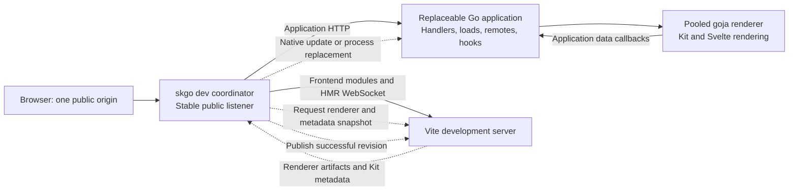
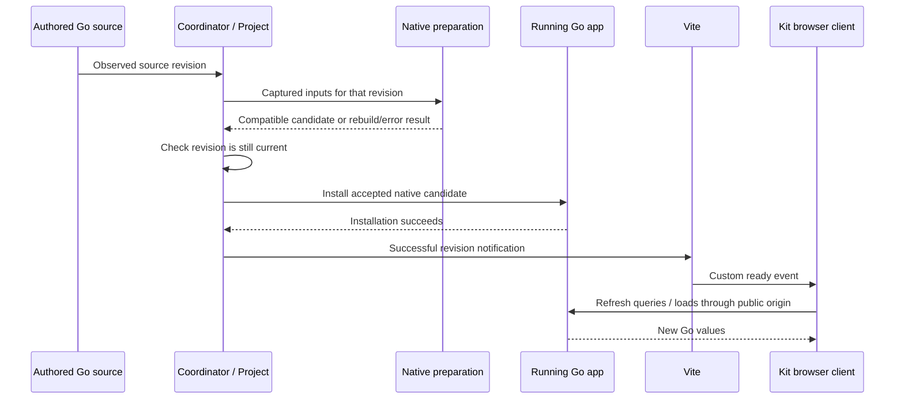

# SKGO development architecture: design and proof-of-concept assessment

**Status: architecture recommendation supported by experiments; product implementation stopped and unmerged.**

Recorded 2026-10-15. Workspace: `/Users/tyler/.codex/worktrees/5f35/skgo`, branch `codex/dev-architecture-experiments`, based on `dev` at `868c5dba9bf1670d2252996b058ecf19bca659ca`. The workspace contains later commits and uncommitted changes; the base is provenance, not a reset target.

## Read this first

**We have enough evidence to choose the coordinator-owned listener and to believe the complete development experience is feasible. We have not answered every hard question.** Native replacement, Go-owned SSR cooperating with Vite, browser refresh without losing healthy state, instance isolation, and real route/remote membership changes have all run. These are no longer merely plausible mechanisms.

The most substantial remaining uncertainty is **coherence during overlapping Go/frontend/route changes**. We proved an observed-revision native publication boundary, and separately demonstrated live structural changes. We have not proved the final combined implementation consistently applies that boundary across all of Vite's generated client graph, Go registrations, renderer artifacts, diagnostics and notifications. The structural experiment actually exposed transient mismatches. The guard rejected them and the system recovered; a subsequent fix has not been fully requalified.

The other important unanswered question is **actual save-to-visible latency across representative edits**. Warm native preparation is substantially faster than the original approximately one-second path, without dropping the demonstrated correctness checks. We did not measure a reliable end-to-end latency distribution. Compiler timing is not the developer's entire wait.

My appraisal: **the central feasibility questions are answered; architecture-wide concurrency and user-visible performance are only partially answered.** That is enough for a design decision, not for claiming a finished development server. No evidence currently requires abandoning coordinator ownership or replacing the native/Go-renderer foundation.

### Scope and authority

The user requested proof-of-concept experiments carried out by subagents, with evidence sufficient to select an architecture. The user permitted choosing the obvious listener recommendation. I incorrectly expanded that into full product implementation and a growing qualification campaign. That expansion was not authorized by the listener choice.

Further implementation and new experiments have stopped. Already-running checks were allowed to finish; agents were not cancelled. Code and evidence remain preserved, unmerged. This document consolidates the design and assesses the evidence; it is not authorization to resume implementation.

[GOAL.md](GOAL.md) remains authoritative. Older plans, reports and index entries record historical positions and may say that a question was undecided or that implementation should continue. This scope correction and the current assessment supersede those descriptions. Candidate tactics are not requirements simply because they were tried or written down.

## Contents

- [Desired experience and boundaries](#desired-experience-and-boundaries)
- [Recommended architecture](#recommended-architecture)
- [Who should own the listener?](#who-should-own-the-listener)
- [Address discovery, SSR and multiple instances](#address-discovery-ssr-and-multiple-instances)
- [How edits reach the browser](#how-edits-reach-the-browser)
- [Native preparation and its correctness boundary](#native-preparation-and-its-correctness-boundary)
- [Kit metadata and renderer integration](#kit-metadata-and-renderer-integration)
- [Failure and recovery behavior](#failure-and-recovery-behavior)
- [Measurements](#measurements)
- [What the hardest questions now look like](#what-the-hardest-questions-now-look-like)
- [Proof quality and limits](#proof-quality-and-limits)
- [Preserved implementation and stopping point](#preserved-implementation-and-stopping-point)
- [Evidence map](#evidence-map)

## Desired experience and boundaries

Run `skgo dev`, open the printed address, save Svelte or Go, and see the change quickly and automatically. Preserve browser drafts and healthy page state when the change permits. Show useful errors and recover when they are fixed.

The responsibilities are:

1. **Vite owns frontend development:** file watching, transforms, dependency graph, frontend HMR and its browser connection.
2. **The Go application owns application behavior:** remote functions, server loads, HTTP endpoints, request hooks and page rendering through the existing pooled goja renderer.
3. **Go development machinery owns Go updates:** observe source changes, prepare and install compatible native replacements, rebuild/restart when necessary, and supervise the application.
4. **The two servers cooperate:** successful Go updates refresh Kit's client through Vite; frontend changes also update the renderer used by Go.

Native live patching is essential to the intended fast path. Preserving arbitrary initialized Go state through a replacement process is not required. Restart is an accepted fallback, not the default answer to every Go body edit.

Application I/O remains in Go. The JavaScript renderer executes Svelte/Kit components and calls back into Go for application values. Generated server/remote stubs throw; successful values must come from Go. There is no Node application server or Node SSR sidecar. Vite is a development/build tool; production remains one cgo-free Go binary. A renderer pool remains necessary under the existing runtime contract.

## Recommended architecture

**The `skgo dev` coordinator owns the stable public listener.** It routes application requests to the replaceable Go application and frontend tooling/HMR requests to Vite. It also owns supervision and upstream address changes.

The coordinator and supervisor are responsibilities within the same Go CLI process. This does not require a fourth service or another distributed system. There are three relevant processes in the demonstrated development arrangement: the CLI/coordinator, Vite, and the replaceable Go application.

The benefit is direct ownership of lifecycle transitions. The process that starts a Go child already learns its actual private address; it updates its own proxy target when that child is ready. It need not teach Vite about every replacement Go port.

This choice costs routing code, an application proxy hop, and a proxied Vite WebSocket. It does not promise higher throughput than the alternatives. No controlled proxy-overhead comparison was performed.

## Who should own the listener?

| Arrangement | Main benefit | Main cost or failure boundary | Assessment |
|---|---|---|---|
| **Vite owns public listener** | Vite directly owns its modules and long-lived HMR connection; Go replacement can leave that connection alone | Go target discovery and retargeting must reach Vite's proxy; Vite failure takes down the public entry point | Viable and actually demonstrated. Not rejected as impossible or intrinsically slow. |
| **Replaceable Go app owns public listener** | Direct application HTTP path | Rebuilding or crashing the app disrupts the public listener and connections unless ownership is moved or transferred | Less suitable for frequent fallback replacement. Extracting durable ownership tends toward the coordinator design. |
| **Coordinator owns public listener** | Supervisor directly owns targeting and failure presentation; app HTTP can survive Vite failure; Vite connection can survive Go replacement | Must route tooling correctly and proxy upgrades, tokens and paths; coordinator itself is a failure boundary | Recommended and selected on the available evidence. |

Socket inheritance could alter the second arrangement, but was not required to prove a workable solution. It also would not by itself preserve an upgraded connection whose owning process exits. There is no reason to introduce it merely to satisfy an earlier tactic.

A coordinator does **not** make Vite restart invisible. When Vite's connection is lost, its own recovery can reload the page and lose drafts. Keeping the public socket alive and preserving browser state are separate claims.

## Address discovery, SSR and multiple instances

### Public origin and private target are different values

The public address must be bound before initializing origin-dependent Kit output. If the requested port is occupied, the actual successful bind determines the origin. A private Go or Vite port may change without changing that public origin.

Each running session needs its own actual upstream addresses, generated frontend output/cache and captured Go state. A fixed machine-wide Go port would defeat instance isolation. Readiness must identify the child and address that actually started; discovering a port without switching forwarding is not sufficient.

The coordinator experiment deliberately occupied port56611. ALPHA bound56612 and used that actual origin; BETA used56621. Both rendered independent values, and replacing ALPHA's private Go address left BETA unaffected. This proves the concept for that collision and two sessions. It does not establish every simultaneous-start race, host binding, TLS arrangement or public-address change mid-session.

### Does Vite need to know where Go is for SSR?

**Not in the demonstrated coordinator design.** Application HTTP goes from the coordinator to Go. Go renders pages using the embedded engine; application data callbacks execute in Go. Vite supplies frontend modules, metadata, renderer artifacts and notifications. Its configuration need not contain the private Go application target.

Vite still needs the correct **public origin** for browser-facing output and connection settings. A Vite-first design additionally needs the private Go target because Vite is doing application proxying. These are separate requirements.

### HMR must genuinely use the public proxy

The browser must connect through the public HMR route, rather than silently falling back to a private Vite address. Tests inspected emitted settings and actual HTTP101 WebSocket traffic. The later command used `/__skgo/dev/hmr` successfully.

Tooling routing includes transformed modules, optimizer-cache URLs and exact HMR paths. Forwarding everything to Go breaks hydration; forwarding every upgrade to Vite can steal an application's WebSocket endpoint. The proxy boundary therefore remains real design work, even though its basic feasibility is settled.

## How edits reach the browser

### Compatible Go body edit

Only success should produce a successful ready notification. A rejected compile should leave the last good application in service and show the authored error. Browser refresh must use the same Kit client module instance as the running app; importing a second copy can call a refresh function that has no effect on the live page.

Actual edits changed the existing example's visible values while retaining its Go PID, browser document and seeded draft. The ready event is a consequence of installation, not a substitute for proof that the real handler changed.

### Frontend component edit

Vite performs normal frontend HMR. Separately, Go must receive the matching renderer artifact and update its renderer pool so a fresh document reflects the same authored component. Browser HMR alone would leave SSR stale; updated SSR alone would not prove frontend HMR.

Both were observed for an actual Svelte heading edit. Matching compiler options matters: Svelte's HMR mode changes emitted DOM markers and CSS behavior. The helper renderer was initially built without the markers the development client expected. That caused a real hydration exception despite a populated recovery page. Matching HMR compilation fixed it; manually patching output HTML was not necessary.

### Structural Go change

A change to initialization, types, imports, dependencies or resources can require a complete new host. Prepare the replacement from captured inputs, establish readiness, and publish its target only when accepted. Subsequent compatible body edits must work against the new host's identity and retained analysis.

This fallback and resumed native updates were executed. Arbitrary in-memory application state is allowed to reset. A public listener remaining stable does not turn process replacement into state preservation.

### Route or remote-function membership change

Kit's client route/node graph, Go registrations/Params, remote identifiers and renderer artifacts must agree sufficiently to serve the changed app. Use the installed Kit implementation to obtain its graph; do not invent a parallel route scanner or infer node identity from a different manifest's array position.

A new route plus Go remote returning7719 worked in fresh SSR and real Kit client navigation. Navigating back to an existing item page still produced the correct values. Removing the new route and remote returned404 while the existing page remained usable.

However, two intermediate replacement attempts were rejected because the fresh route manifest lacked matching generated Go Params. A later observation repaired the pair. That demonstrates useful fail-closed behavior and eventual recovery, **not** complete cross-runtime atomicity. A later admission fix exists but has not completed its combined verification.

## Native preparation and its correctness boundary

The speedup came from retaining suitable discovery/type-analysis state, not from removing the existing classifier or trusting unchecked code.

The qualified experiment source-checked the application roots and affected reverse-import callers, including a local replacement module outside the main application tree. It retained unchanged dependency type information while rechecking changed roots and callers. It kept the real native compiler, lowering, object identity, HostView admission and dependency archive checks.

Simply running the original recursive syntax request through a retained View did not help: it fell back to full acquisition. The successful experiment changed the acquisition shape while preserving the demonstrated coverage.

Changes that invalidate the host's dependency assumptions require rebuilding. Test files ordinarily do not participate in the served executable; files actually selected by `go:embed` do. Later tests exercised that distinction and new embedded-file membership. Retained analysis was bounded; six successive compatible edits and replacement cleanup were exercised. This is not a long-session memory-growth benchmark.

### Stale revision exclusion

The publication experiment captured revision2, admitted newer revision3, and only then compiled revision2. Its object still contained revision2's literal, proving that it did not silently reread current source. Commit rejected the obsolete candidate before installation and notification. Actual Vite frames omitted revision2. Removing the revision guard in a private mutation caused the intended failure.

This establishes ordering at the **observed-revision** boundary. It does not make separately written files an arbitrary filesystem transaction, or make an event that has not reached the observer already visible to the scheduler. Production event acquisition, batching, startup races and frontend/Go coordination are additional concerns.

## Kit metadata and renderer integration

The tested artifact approach asks Vite/Kit for live metadata and a renderer bundle that Go can load. It uses pinned Kit internals, including manifest creation and sync, rather than recreating their graph in Go. That is a workable seam with a version-coupling cost. It is not a stable upstream adapter API guaranteed across future Kit releases.

The installed authoritative sources were Kit3.0.0 and Svelte5.57.1. Frontend tools run through VitePlus. Cached upstream Vite mappings and the installed VitePlus runtime are distinguished in the underlying reports.

Earlier experiments also explored fresh and retained ModuleRunner rendering paths. They are evidence and potential alternatives, not requirements. The artifact path now has sufficient joined browser/SSR proof that another rendering-strategy search is not needed to choose the listener architecture. No controlled end-to-end comparison establishes it as universally fastest.

Development differs from production in more than HMR. For example, Kit executes prerender remote functions during development while production may use recorded output. The real About page exposed that gap. Explicit development-mode Go dispatch and handler/SSR tests now exist, preserving production recorded-output guards; final combined browser confirmation of that change was not performed.

The final focused adapter checks also exercised static files, validated public/private environment values, public environment rendering, private-module refusal and Vite instance identity after an internal restart. Those are focused handler/adapter results, not a claim that every final change ran together in the real example browser.

## Failure and recovery behavior

| Event | Demonstrated behavior | Limit |
|---|---|---|
| Bad Go source | Last-good values remain; authored file/line appears; repair refreshes data and clears overlay | Not every error class or arbitrary edit sequence tested |
| Go process crash | Stable coordinator reports unavailable during absence, replaces target after readiness; observed Vite connection and browser state survive in the coordinator fixture | Arbitrary initialized Go state does not survive by promise |
| Vite process failure | Application HTTP remains available; tooling is unavailable until restart | Vite's browser reconnect can reload and lose drafts |
| Structural route edit | New route/remote becomes usable, existing route survives node shift, removal works | Transient metadata mismatch occurred; final admission fix not fully verified |
| Coordinator failure | It owns the public listener, so the public entry point is lost | No coordinator high-availability claim or requirement |
| Concurrent sessions | Two sessions kept independent values, origins and recovery | Not a stress test of many sessions or all startup races |

Earlier crash recovery reinstalled a known successful candidate without recompiling it. Other paths rebuild a host from captured good inputs. These are different implementation tactics; the architectural result is that only a ready usable target is published, not that all recovery must use one mechanism.

## Measurements

These are observed samples, primarily on Go1.27.2, darwin/arm64, cgo disabled. They are not statistical service-level objectives. Initial and warm costs differ, and the fixtures do not all perform identical work.

| Measurement | Observed time | What it establishes |
|---|---:|---|
| Original joined full-preparation path | roughly0.9–1.1s per successful detected Go edit; some runs slower | The approximately one-second cost was repeated work, not just startup |
| Same-app full whole-application preparation | 831.933–880.496ms | Controlled comparison baseline |
| Whole-app retained preparation | 548.236ms cold;150.521–168.108ms warm | Retention materially reduces preparation while keeping exercised checks |
| Installation in that retained comparison | about3.8–3.9ms | Installation is a small additional stage in this fixture |
| Retained preparation joined to a real browser fixture | 793.424ms cold;161.491–176.658ms warm, plus about3.7–3.9ms install | Speedup survives actual native handler/browser updates; frontend was production-built in this fixture |
| Captured Project preparation plus native preparation | approximately217–227ms in one joined lane; roughly48ms Project +161ms native in a later sample | Capturing/generating inputs adds real cost beyond the compiler-only number |
| Actual development command, three successful native revisions | 729.434ms,255.784ms,193.975ms preparation;0.480ms,1.008ms,0.560ms install | Real example native updates and browser refresh worked; these timings exclude Project capture/generation and paint |
| Structural host rebuild/profile/readiness | 2.359s, one cached fixture | Rebuild fallback can produce a usable host and resume patching |
| Renderer artifact/pool replacement | roughly72–78ms in bounded earlier fixtures | This stage can be small; not complete frontend save-to-visible latency |

**The historical137–138ms result was not a false lead.** It was a narrower experiment that motivated the retained approach. The richer whole-app checks subsequently measured150–177ms warm preparation in their fixtures. The actual command samples were different again. Promoting137ms to a promise for every Go save would be false.

We did not measure: a representative save-to-paint distribution; a reliable worst case; many-file application scaling; proxy throughput/overhead; long-session memory growth; or equivalent results across supported operating systems and toolchains. In particular, the one-second question is answered as a mechanism question—repeated full preparation is avoidable—but not as a universal end-to-end performance guarantee.

## What the hardest questions now look like

| Question | Honest answer | Confidence boundary |
|---|---|---|
| Can Vite development and Go-owned application/SSR coexist without Node application I/O? | **Yes.** Real pages hydrate, frontend HMR works, Go supplies application values and SSR. | Bounded apps and pinned versions |
| Can ordinary Go edits avoid full rebuild and remain meaningfully fast? | **Yes.** Actual native updates and retained whole-app checks ran; same-app preparation improved substantially. | Not every Go change is patchable; total visible latency remains unmeasured |
| Can the browser refresh those values without losing healthy state? | **Yes for the exercised compatible edits and repair.** Draft/document/PID were observed. | Structural frontend changes and Vite restart can reload |
| Can multiple sessions find the right Go process without fixed ports? | **Yes for demonstrated sessions.** Actual private readiness and coordinator-owned target replacement worked. | Final expanded collision/startup implementation checks are incomplete |
| Must Vite know the private Go port for SSR? | **No in this composition.** Go owns SSR/data; Vite supplies tooling/artifacts. | Vite still needs the correct public origin |
| Can real Kit route/remote membership be synchronized into Go? | **Yes as a demonstrated mechanism.** Added7719 route/remote, client navigation, existing route and removal all worked. | Cross-runtime behavior during overlapping revisions remains partly open |
| Can obsolete native work be prevented from publishing? | **Yes at the exercised Observe/Commit boundary.** Private mutation proved the guard matters. | Final unified scheduler and all acquisition races are not established |
| Is the final combined implementation correct and release-ready? | **No such conclusion is supported.** | Full final regression and several combined runtime checks did not complete |

### The remaining hard design question

The central remaining question is the behavior of **overlapping structural and ordinary updates**: what the browser may observe while Vite has changed client metadata but Go is still preparing its corresponding host and renderer.

That is more than a missing unit test. It requires a clear publication policy and proof that the actual cooperating processes follow it. However, demanding globally atomic arbitrary file writes would introduce a new requirement the user did not ask for. The useful design target is concrete: avoid falsely announcing readiness, avoid silently serving incompatible metadata, preserve last-good behavior where possible, and recover predictably. Whether a brief visible error/reload during a structural save is acceptable should be an explicit UX/design decision, not an accidental consequence or an invented perfection requirement.

The other unresolved questions—total latency, long-run retention, startup/restart edge cases and Kit-version coupling—matter for a dependable implementation. They do not currently overturn the selected topology. If later implementation is authorized, those are the focused questions to settle; another open-ended architecture search is not justified by the evidence we have.

## Proof quality and limits

We did not rely only on green commands. Independent private mutations exercised whether the assertions were meaningful:

- A successful-looking no-op native install left the old literal and failed the real-handler expectation.
- Removing the observed-revision guard admitted obsolete installation and failed the stale-publication assertion.
- Routing tooling to the app failed HTTP identity and WebSocket-upgrade expectations.
- Keeping the old Go proxy target after replacement failed the new literal expectation despite a replacement being logged.
- Disabling the matching HMR compiler setting failed the expected SSR marker assertion.
- Dependency/caller controls rejected incompatible input; an actual privately altered dependency archive was rejected by HostView admission.

Browser observations separately checked visible literal values, hydration errors, drafts and document identity. Paired structural manifests/client output were retained for the later route experiment. Some earlier screenshots were inspected but not saved; this document does not claim screenshot artifacts that do not exist.

Evidence was accumulated across different revisions and fixtures. No single run proves every row in this document simultaneously. Earlier successful lifecycle tests remain evidence for their executed revision. Later startup/currentness, combined-update and internal-Vite-restart changes are not automatically covered by those earlier passes.

The final expanded coordinator run failed an assumption about where Kit's origin substitution would appear, first in a tree-shaken renderer bundle and then in a requested frontend module. That is **an incomplete validation**, not demonstrated origin misrouting and not a pass. An earlier coordinator experiment did demonstrate actual occupied-port origin handling. Both facts must remain visible.

The final focused adapter checks passed in4.128s; explicit dev-prerender handler/SSR plus production guard checks passed in0.233s. The final combined normal Go and production browser suites were not run to completion. They are not prerequisites for believing the POC feasible, but would be required evidence before claiming a completed product change.

## Preserved implementation and stopping point

Implementation work exceeded the intended POC scope. It includes:

- CLI/coordinator work in `cmd/skgo/dev.go`, command dispatch, and `internal/devserver/`.
- Maintained native host/captured input/retained analysis work in `internal/hotreload/`.
- Development adapter/renderer/metadata/environment glue in `internal/adapter/`.
- Explicit development prerender behavior in the root Go handler/manifest surfaces.
- Tests, README changes, experimental source archives and worklogs.

Some work is locally committed, including `7fa4bc6` (native host API), `69038f2` (native bounds/admission/cleanup) and `78f02f5` (development prerender behavior); coordinator/adapter work also remains uncommitted. None of this is represented here as a reviewed merge-ready delivery. No PR or merge is part of this assessment.

The authorized endpoint is this consolidated design and evidence appraisal. No further product edits, benchmark campaigns or regression runs are started by writing it. Existing work remains available if the user later chooses to adopt, revise or discard it.

## Evidence map

The token cache is `/Users/tyler/src/skgo-token-cache`; entrypoint `index/README.md`. The current product-observation route is `index/dev-product-command.md`, with explicit scope and evidence limits. Use it to retrieve source slices, not as an authority overriding GOAL or the user.

| Topic | Primary local evidence |
|---|---|
| User goal | [GOAL](GOAL.md), corrected [PLAN](PLAN.md), corrected [CONTINUE](CONTINUE.md) |
| Three listener alternatives and pinned source | [Listener ownership](../../experiments/20261015-listener-ownership/README.md) |
| Two actual coordinator-fronted browsers, collision and recovery | [Coordinator report](../../experiments/20261015-coordinator-integration/REPORT.md), [browser observations](../../experiments/20261015-coordinator-integration/browser/OBSERVATIONS.md) |
| Same-app preparation comparison, correctness and browser join | [Retained qualification](../../experiments/20261015-retained-qualification/REPORT.md), [independent validation](../../experiments/20261015-retained-validation/REPORT.md) |
| Captured input, obsolete exclusion, actual Vite events and rebuild | [Publication report](../../experiments/20261015-retained-publication/REPORT.md), [mutation validation](../../experiments/20261015-publication-validation/REPORT.md) |
| Actual command browser observations | [Browser log](../../dev-browser.log), [structural/clean hydration/HMR observations](../../experiments/20261015-product-structure/OBSERVATIONS.md) |
| Real session and wrong-target negative control | [Original](../../experiments/20261015-devserver-validation/real-session-original.log), [mutation failure](../../experiments/20261015-devserver-validation/real-session-mutant.log) |
| Native install negative control | [Original](../../experiments/20261015-native-host-validation/original.log), [no-op failure](../../experiments/20261015-native-host-validation/noop-install.log) |
| Final focused adapter check and causal HMR marker control | [Focused run](../../experiments/20261015-live-metadata/product-final-all-controls.log), [no-HMR failure](../../experiments/20261015-live-metadata/negative-no-hmr.log) |
| Development prerender / preserved production guards | [Handler and SSR results](../../development-prerender-test.log) |
| Latest expanded coordinator attempt, not a qualified pass | [Latest log](../../dev-session-integration.log), [earlier origin assumption](../../dev-session-integration-origin-assumption.log) |
| Scope correction and traps worth preserving | [Worklog](../../worklog/20261015-architecture-experiments.md) |
